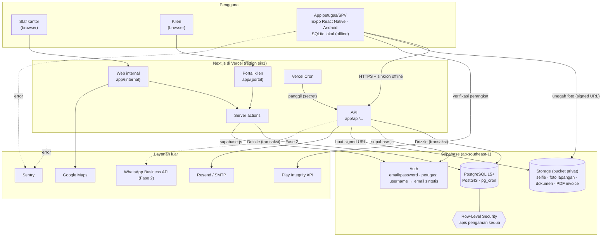
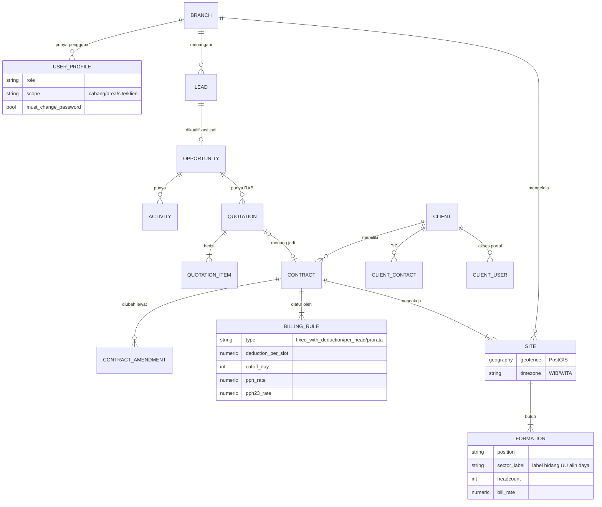
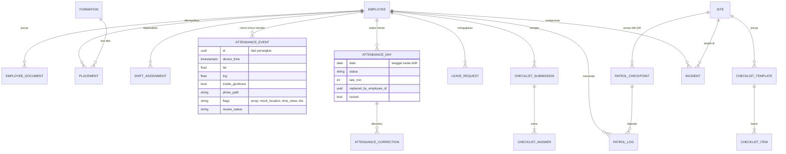
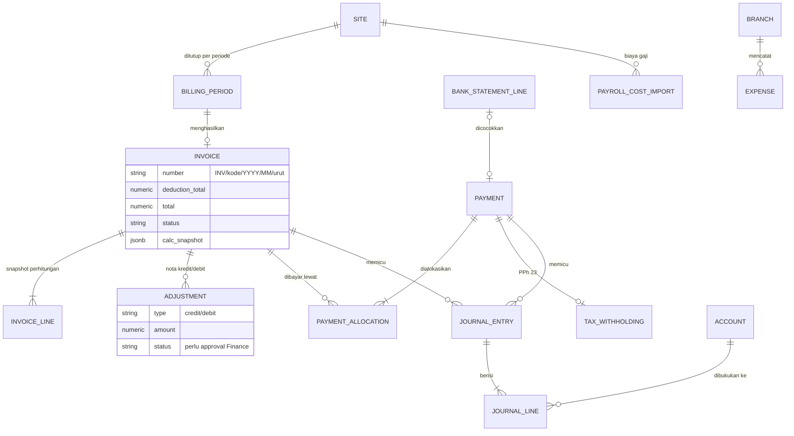

# TRD: Technical Requirements Document
## IPS One — Platform Operasional Terintegrasi PT IPS

| | |
|---|---|
| Versi | 0.2 (draft) |
| Tanggal | 1 November 2026 |
| Dokumen terkait | [01-BRD.md](01-BRD.md), [02-PRD.md](02-PRD.md) |

> **Konteks pembangun:** sistem dibangun oleh **satu orang (pemilik) dibantu AI**, tanpa tenggat keras. Karena itu desain di dokumen ini memilih layanan terkelola sebanyak mungkin. Tujuannya meminimalkan server yang harus dirawat sendiri, dan menaruh tenaga di logika bisnis (absensi, invoice).

---

## 1. Ringkasan arsitektur

**Pola:** satu aplikasi web full-stack (Next.js) + satu aplikasi HP (Expo) + Supabase sebagai database, autentikasi, dan penyimpanan berkas. Tidak ada server backend terpisah.



**Alasan:**
- Satu basis kode TypeScript untuk web, API, portal; satu untuk mobile; kode bersama di `packages/shared`.
- Supabase mengurus backup, auth, storage, dan RLS. Tidak ada server yang perlu di-patch sendiri.
- Semua penulisan data penting (absensi, invoice, pembayaran) lewat API Next.js di sisi server, jadi validasi ada di satu tempat.

## 2. Prinsip teknis

1. **Satu sumber kebenaran.** Absensi mentah disimpan sebagai *event* yang tidak diubah. Status harian dihitung dari event + koreksi.
2. **Uang tidak pernah dihitung ulang diam-diam.** Invoice yang terbit menyimpan *snapshot* perhitungan. Perubahan setelah terbit hanya lewat **nota kredit/debit yang disetujui Finance**.
3. **Logika bisnis = fungsi murni yang diuji.** Perhitungan status absensi, potongan, invoice, RAB, dan jurnal ditulis sebagai fungsi TypeScript murni di `packages/shared` dengan unit test. Ini juga membuat kerja dengan AI lebih aman: perubahan langsung ketahuan kalau tes gagal.
4. **Offline-first di HP.**
5. **Isolasi data per cakupan** (cabang/area/site/klien), dicek di server **dan** di RLS.
6. **Yang bisa berubah = konfigurasi:** tarif pajak, UMK, label bidang posisi, alasan menang/kalah, aturan tagih, batas approval.
7. **Log audit** untuk data uang dan absensi.

## 3. Stack teknologi

| Lapisan | Pilihan | Catatan |
|---|---|---|
| Bahasa | TypeScript | Web, API, mobile, shared |
| Monorepo | pnpm workspaces (+ Turborepo opsional) | `apps/web`, `apps/mobile`, `packages/shared` |
| Web + API | Next.js (App Router), React Server Components, route handlers | Satu deploy untuk web internal, portal, dan API |
| UI | Tailwind + shadcn/ui + TanStack Table | Tabel, form, dialog siap pakai |
| Validasi | Zod (dipakai bersama web, API, mobile) | |
| Database | Supabase Postgres + PostGIS + pg_cron | Region **ap-southeast-1 (Singapura)**, lihat bagian 7 |
| ORM & migrasi | Drizzle ORM + drizzle-kit | Transaksi di server; migrasi tersimpan di repo |
| Auth | Supabase Auth | Lihat 7.1 |
| Storage | Supabase Storage (bucket privat + signed URL) | |
| Grafik & peta | Recharts/ECharts; Google Maps JS API (gambar geofence) | |
| PDF | `@react-pdf/renderer` di server | Tidak butuh Chromium, cocok untuk serverless |
| Email | Resend (atau SMTP domain perusahaan) | Domain sendiri dengan SPF/DKIM, bukan @gmail.com |
| Jadwal | pg_cron (job SQL: agregasi KPI, pengingat) + Vercel Cron (job yang kirim email/PDF) | |
| Mobile | Expo (dev build) + expo-sqlite + expo-location + expo-camera + modul Play Integrity | Android dulu; iOS tidak diperlukan untuk petugas |
| Hosting web | Vercel (fungsi di region `sin1`) | |
| Observabilitas | Sentry (web & mobile), log Vercel & Supabase | |
| CI | GitHub Actions: lint, typecheck, test; EAS Build untuk APK | |

**Jalan keluar bila tumbuh:** Next.js bisa dipindah ke container sendiri dan Supabase bisa di-*self-host* atau diganti Postgres biasa (skema dan Drizzle tetap sama). Jadi pilihan ini tidak mengunci.

## 4. Model data

### 4.1 Entitas utama

Dibagi tiga diagram supaya terbaca. Entitas yang sama (mis. `SITE`, `EMPLOYEE`) muncul di lebih dari satu diagram sebagai titik sambung.

**a. Penjualan & kontrak**



**b. SDM & operasi lapangan**



**c. Keuangan**



Entitas pendukung tanpa relasi utama: `COMPANY_DOCUMENT` (brankas dokumen legal), `AUDIT_LOG`, `NOTIFICATION`, `SETTING`, `UMK_RATE`.

### 4.2 Tabel kunci (ringkas)

| Tabel | Kolom penting |
|---|---|
| `sites` | id, client_id, contract_id, branch_id, name, address, `geofence geography(Polygon)`, radius_m, timezone (`Asia/Jakarta`/`Asia/Makassar`) |
| `formations` | id, site_id, position_id, `sector_label` (cleaning/security/transport/support/at_risk), headcount, shift_pattern_id, bill_rate, valid_from, valid_to |
| `placements` | id, employee_id, formation_id, slot_no, start_date, end_date, is_backup |
| `attendance_events` | id (UUID dari perangkat), employee_id, site_id, type (in/out), device_time, server_time, lat, lng, accuracy_m, inside_geofence, photo_path, `flags[]` (mock_location, integrity_fail, time_skew, outside_fence), device_id, shared_device_by, review_status |
| `attendance_days` | employee_id, site_id, formation_id, slot_no, date, shift_id, status, late_min, overtime_min, replaced_by_employee_id, locked |
| `billing_rules` | contract_id, site_id (null = semua site), type (`fixed_with_deduction`/`per_head`/`prorata`), amount, `deduction_per_slot` (null = hitung otomatis), `deduct_leave` (bool), `late_as_absent_min`, cutoff_day, payment_term_days, ppn_rate, ppn_base (full/fee_only), pph23_rate |
| `invoices` | id, number, client_id, contract_id, site_id, period_start, period_end, subtotal, deduction_total, ppn, total, pph23_expected, status (draft/pending_approval/approved/issued/sent/partially_paid/paid/void), approval_level, issued_at, due_date, pdf_path, `calc_snapshot jsonb` |
| `adjustments` | id, invoice_id, type (credit/debit), reason, source_correction_ids[], amount, ppn, status (draft/approved/issued), approved_by |
| `journal_lines` | entry_id, account_id, debit, credit, branch_id, contract_id, site_id |

Semua tabel punya `created_at`, `updated_at`, `created_by`. Data transaksi uang **tidak pernah dihapus**: dibatalkan lewat status `void` + nota.

### 4.3 Aturan data

- Uang: `numeric(18,2)` Rupiah, bukan float.
- Waktu: `timestamptz` (UTC), tampil sesuai zona waktu site (WIB/WITA).
- Shift malam yang melewati tengah malam dihitung ke **tanggal mulai shift**.

## 5. Desain modul kritis

### 5.1 Absensi & anti-kecurangan

**Di HP (check-in):**
1. Ambil lokasi (target akurasi ≤ 50 m, tunggu maks. 10 detik).
2. Cek `mocked` dari expo-location dan verdict **Play Integrity** (perangkat asli, aplikasi asli).
3. Ambil selfie dari kamera depan (tanpa akses galeri), dikompres ±120 KB.
4. Simpan event ke SQLite dengan UUID, waktu perangkat, dan waktu sejak boot (untuk mendeteksi jam HP diubah).
5. Kirim ke `POST /api/mobile/attendance-events`. Kalau gagal, masuk antrean dan dikirim ulang otomatis.

**Di server:**
1. Idempotent berdasarkan UUID event.
2. Cek geofence dengan PostGIS (`ST_DWithin` / `ST_Contains`).
3. Bandingkan waktu perangkat vs server → flag `time_skew`.
4. Event ber-flag **tetap disimpan** dengan `review_status = perlu_tinjau`; SPV/Ops yang memutuskan.
5. Hitung ulang `attendance_days` terkait (fungsi murni di `packages/shared`).

**Face match: ditunda.** Fase 1 memakai selfie + geofence + Play Integrity + **pemeriksaan acak foto oleh SPV** (layar "tinjau 10 selfie acak per hari"). Face match otomatis dievaluasi setelah pilot berdasarkan tingkat kecurangan yang ditemukan. Alasannya: mengurangi beban teknis untuk satu pembangun dan mengurangi pemrosesan data biometrik (UU PDP).

**Mode HP bersama** (cadangan): HP didaftarkan sebagai perangkat site; petugas memilih nama + selfie; `shared_device_by` diisi.

### 5.2 Mesin perhitungan invoice (per site)

```
untuk setiap site dengan periode yang ditutup:
  periode = (cutoff bulan lalu + 1) .. cutoff bulan ini
  rule = billing_rule site (atau rule kontrak)

  slot_wajib   = untuk setiap formasi: Σ hari kerja × headcount (prorata bila formasi berubah di tengah periode)
  slot_kosong  = slot wajib tanpa attendance_day berstatus {hadir, telat ≤ late_as_absent_min, diganti}
                 (izin/sakit dihitung kosong bila deduct_leave = true)

  fixed_with_deduction (default):
      baris_pokok = amount
      tarif_potong = deduction_per_slot ?? (bill_rate formasi ÷ hari kerja periode)
      baris_potongan = − Σ slot_kosong × tarif_potong   (rincian per formasi & tanggal)
  per_head:  baris = bill_rate × headcount
  prorata:   baris = bill_rate × slot_terisi ÷ slot_wajib
  + baris manual (proyek, chemical)

  subtotal → PPN (sesuai ppn_base) → total
  pph23_expected = pph23_rate × dasar yang dikonfigurasi
  simpan calc_snapshot → status draft
  bila total > batas approval direksi (Setting) → pending_approval level direksi
```

- **Tutup periode** mengunci `attendance_days`.
- **Koreksi setelah terkunci:** koreksi disimpan, sistem menghitung ulang periode itu, lalu membuat **draft nota kredit** (tagihan turun) atau **nota debit** (tagihan naik) sebesar selisihnya. Nota hanya terbit setelah disetujui Finance.
- Penomoran: `INV/{kode_cabang}/{YYYY}/{MM}/{urut}`, `NK/...` untuk nota kredit, `ND/...` untuk nota debit. Urutan dijamin unik dengan tabel counter yang dikunci dalam transaksi.
- Persistensi invoice terjadi dalam **satu transaksi Drizzle** (invoice + baris + jurnal + kunci periode).
- **Tes wajib:** setiap tipe aturan, potongan dengan/ tanpa tarif tetap, izin dipotong/tidak, telat jadi alfa, formasi berubah di tengah periode, shift malam, petugas pengganti, koreksi setelah terbit → nota kredit/debit.

### 5.3 Jurnal otomatis

| Kejadian | Debit | Kredit |
|---|---|---|
| Invoice terbit | Piutang usaha | Pendapatan jasa; PPN keluaran |
| Pembayaran diterima | Kas/Bank; PPh 23 dibayar dimuka | Piutang usaha |
| Nota kredit | Pendapatan jasa; PPN keluaran | Piutang usaha |
| Nota debit | Piutang usaha | Pendapatan jasa; PPN keluaran |
| Biaya dicatat | Beban (kategori) | Kas/Bank atau Utang |
| Impor biaya gaji | Beban gaji langsung (per site) | Utang gaji |

Margin kotor per site/kontrak = pendapatan − (beban gaji langsung + biaya langsung yang ditandai ke site/kontrak).

Format ekspor ke software akuntansi dan payroll **menunggu hasil Fase 0** (software yang dipakai sekarang belum diketahui). Sementara itu sediakan ekspor Excel generik yang rapi.

### 5.4 Sinkronisasi offline (mobile)

- **Turun:** jadwal 7 hari ke depan, data site & geofence, template ceklis, titik patroli; diambil delta berdasarkan `updated_at` saat aplikasi dibuka.
- **Naik:** antrean lokal berurutan. Foto diunggah dulu ke Storage via signed upload URL, lalu event dikirim dengan `photo_path`.
- **Konflik:** event bersifat append-only, jadi tidak ada konflik tulis. Data master selalu mengikuti server.
- Target offline: 72 jam.

### 5.5 Dashboard

- KPI dari tabel ringkasan (`kpi_daily_branch`, `kpi_daily_site`, `kpi_monthly_site`) yang diperbarui **pg_cron** tiap 10 menit dan saat tutup periode.
- Monitor absensi hari ini membaca tabel absensi langsung (terindeks), dengan Supabase Realtime atau polling 30 detik.

## 6. API (route handler Next.js)

| Metode | Endpoint | Fungsi |
|---|---|---|
| POST | `/api/public/leads` | Form lead dari website (rate limit + captcha) |
| POST | `/api/opportunities/:id/close` | Wajib `result`, `reason_code`, `competitor` |
| POST | `/api/quotations/:id/convert` | RAB → kontrak + site + formasi |
| GET | `/api/mobile/sync?since=` | Data turun untuk aplikasi |
| POST | `/api/mobile/attendance-events` | Batch event absensi |
| POST | `/api/mobile/uploads` | Signed upload URL foto |
| POST | `/api/billing-periods/:id/close` | Tutup periode + draft invoice |
| POST | `/api/invoices/:id/approve` · `/issue` · `/send` | Siklus invoice |
| POST | `/api/adjustments/:id/approve` | Persetujuan nota kredit/debit oleh Finance |
| POST | `/api/payments` | Pembayaran + alokasi + PPh 23 |
| POST | `/api/bank-statements/import` | Impor CSV mutasi |
| GET | `/api/cron/*` | Dipanggil Vercel Cron (dilindungi secret) |

Halaman web internal dan portal sebagian besar memakai **server actions** dan query langsung di server component; route handler di atas terutama untuk aplikasi HP, form publik, dan cron.

## 7. Keamanan & privasi

### 7.1 Autentikasi

| Pengguna | Cara |
|---|---|
| Staf kantor & klien | Email + password (Supabase Auth). 2FA (TOTP) wajib untuk Direksi & Finance |
| Petugas | **Username + password awal** dibuat admin/HR. Di Supabase, username dipetakan ke email sintetis (`{username}@petugas.ips-one.internal`) yang tidak pernah dipakai untuk kirim email. Kolom `must_change_password = true` memaksa ganti password saat login pertama. Reset oleh SPV/HR menghasilkan password sementara baru dan mengembalikan flag ke `true` |
| Tambahan untuk petugas | Satu akun terikat ke satu perangkat (device ID tercatat saat login pertama); pindah HP harus disetujui SPV. Mencegah titip absen dengan login di HP teman |

Aturan password: minimal 8 karakter, tidak boleh sama dengan password awal; login dikunci 15 menit setelah 5 kali gagal.

### 7.2 Otorisasi & data

| Area | Ketentuan |
|---|---|
| Otorisasi | RBAC + cakupan di server; **RLS di semua tabel** sebagai lapis kedua (fungsi bantu `auth_scope_branches()`, `auth_scope_clients()`) |
| Portal klien | Hanya data site miliknya. **Foto selfie tidak pernah dikirim ke portal**: query portal memakai view tanpa kolom `photo_path`, dan bucket selfie tidak bisa diakses peran klien |
| Enkripsi | TLS; enkripsi at-rest bawaan Supabase; kolom sensitif (NIK, no. rekening, no. BPJS) dienkripsi di aplikasi (pgsodium/Vault atau AES di server) |
| Foto selfie | Data pribadi; persetujuan tertulis karyawan saat onboarding; signed URL berumur ≤ 5 menit; **retensi 12 bulan** lalu dihapus otomatis oleh pg_cron + job storage |
| Log audit | Trigger Postgres pada tabel absensi, koreksi, kontrak, invoice, nota, pembayaran, pengguna |
| Lokasi data | Supabase & Vercel di **Singapura**. PP 71/2019 membolehkan PSE lingkup privat menyimpan data di luar negeri; UU PDP mensyaratkan perlindungan setara untuk transfer ke luar negeri, jadi dicantumkan di kebijakan privasi dan persetujuan karyawan. **Perlu dicek ke konsultan hukum**; bila diwajibkan di Indonesia, pindah ke Postgres terkelola region Jakarta |
| Kunci rahasia | `service_role` Supabase hanya di server, tidak pernah di aplikasi HP atau browser |

## 8. Kebutuhan non-fungsional

| Area | Target |
|---|---|
| Kapasitas | 5.000 petugas, ±15.000 event absensi/hari, puncak ±2.000 check-in dalam 30 menit |
| Respons | Check-in p95 < 1,5 detik; halaman web p95 < 2 detik |
| Ketersediaan | Mengikuti SLA Supabase & Vercel (paket berbayar) |
| Backup | Supabase Pro: backup harian; aktifkan **PITR** saat go-live penuh; ekspor `pg_dump` mingguan ke penyimpanan terpisah |
| Mobile | Android 8.0+, RAM 2 GB, APK ≤ 30 MB, offline 72 jam |
| Web | Chrome/Edge terbaru, responsif (kepala cabang sering pakai HP) |

**Perkiraan penyimpanan:** selfie 2/hari × 5.000 × 30 × ±120 KB ≈ 36 GB/bulan, foto lapangan ±2× lipat → ±100 GB/bulan; dengan retensi 12 bulan ±1,2 TB saat skala penuh. Pilot (±300 petugas) hanya ±6 GB/bulan.

## 9. Integrasi

| Integrasi | Fase | Cara |
|---|---|---|
| Form lead website | 1 | POST ke `/api/public/leads` |
| Email invoice & pengingat | 1 | Resend/SMTP, domain perusahaan |
| Google Maps | 1 | Geofence & lokasi |
| Play Integrity API | 1 | Verifikasi perangkat |
| Mutasi bank BCA/Mandiri | 1 | Unggah CSV/Excel |
| Ekspor payroll & akuntansi | 1 | Excel generik dulu; format khusus setelah software diketahui |
| Ekspor e-Faktur/Coretax | 1 | Format impor Coretax |
| WhatsApp Business API | 2 | BSP resmi atau Meta Cloud API |
| Virtual account | 3 | Xendit / Midtrans |

## 10. Urutan pengerjaan (untuk satu pembangun)

Dibangun berurutan supaya setiap tahap sudah bisa dipakai. Rantai **absensi → invoice** didahulukan karena menggantikan aplikasi lama dan langsung berdampak ke arus kas. CRM tidak bergantung pada modul lain, jadi aman dikerjakan sesudahnya.

| Tahap | Isi | Hasil yang bisa dipakai |
|---|---|---|
| 1. Fondasi | Repo, Supabase, auth & peran, cabang, UMK, posisi & label bidang, pengaturan, log audit | Admin bisa login & atur master data |
| 2. Brankas dokumen | Dokumen legal + pengingat kedaluwarsa | *Quick win*: APKLINDO & dokumen lain terpantau |
| 3. Klien, kontrak, site, karyawan | Klien & PIC, kontrak, aturan tagih, site + geofence, formasi, impor karyawan Excel, penempatan | Data operasional cabang pilot lengkap |
| 4. Aplikasi absensi | Login & ganti password, jadwal, check-in/out offline, izin/sakit, monitor SPV, pengganti, tinjau selfie, koreksi, ekspor rekap payroll | **Mulai uji paralel di Surabaya** |
| 5. Invoice & piutang | Tutup periode, potongan, PDF, approval, kirim email, pembayaran, PPh 23, aging, nota kredit/debit, jurnal otomatis, ekspor | Uji paralel invoice 2 periode |
| 6. Leads, CRM, RAB | Lead, pipeline, aktivitas, alasan menang/kalah, RAB + margin, RAB → kontrak | Tim sales pilot pakai CRM |
| 7. Aktivitas lapangan | Ceklis + foto, patroli QR, insiden, kunjungan SPV | |
| 8. Dashboard & portal | Dashboard direksi & cabang, biaya & margin, portal klien baca saja, laporan bulanan PDF | **Gate pilot** (BRD bagian 13) |
| 9. Cabang pilot ke-2 | Cabang luar Jatim: uji zona WITA/WIB & jarak | Siap roll-out |

**Cara kerja dengan AI:**
- Simpan `CLAUDE.md` di repo berisi ringkasan domain, aturan kode, dan perintah tes.
- Satu fitur per branch/PR kecil, dengan tes untuk setiap logika uang dan absensi.
- Migrasi database selalu lewat file migrasi (tidak edit skema langsung di dashboard Supabase).
- Gunakan proyek Supabase terpisah untuk `staging` dan `production`.

## 11. Pengujian & rilis

- **Unit test (Vitest):** semua fungsi di `packages/shared` (absensi harian, potongan, invoice, RAB, jurnal).
- **Integration test:** alur kontrak → absensi → tutup periode → invoice → pembayaran → jurnal, terhadap Postgres lokal (Supabase CLI).
- **E2E (Playwright):** login, tutup periode, approval invoice, portal klien tidak bisa melihat foto selfie.
- **Uji RLS:** tes otomatis bahwa pengguna cabang A tidak bisa membaca data cabang B, dan klien tidak bisa membaca klien lain.
- **Uji lapangan:** HP Android murah, basement mal, mode pesawat 24 jam lalu online.
- **Uji paralel invoice:** 2 periode di Surabaya; selisih harus ≤ 0,5% dan bisa dijelaskan.
- **Rilis mobile:** Play Store internal testing → closed testing (pilot) → produksi; EAS Update untuk perbaikan cepat.
- **Feature flag per cabang** untuk roll-out bertahap.

## 12. Migrasi data

| Data | Sumber | Cara |
|---|---|---|
| Cabang, UMK | Manual | Seed |
| Klien & PIC | Excel/arsip sales | Impor + deduplikasi |
| Kontrak, site, formasi | Dokumen kontrak + RAB | Input terpandu, mulai dari Surabaya |
| Karyawan aktif | Ekspor aplikasi absensi lama | Impor Excel + validasi NIK; akun & password awal dibuat massal, dicetak per site untuk dibagikan SPV |
| Piutang awal | Finance | Impor invoice terbuka sebagai saldo awal |
| Dokumen legal | Arsip | Unggah manual |

## 13. Struktur repositori

```
coba-dashboard/
├── apps/
│   ├── web/              # Next.js: app/(internal), app/(portal), app/api
│   └── mobile/           # Expo React Native
├── packages/
│   └── shared/           # fungsi murni: absensi, potongan, invoice, RAB, jurnal; skema Zod; tipe
├── supabase/             # config, seed, kebijakan RLS, fungsi SQL, pg_cron
├── drizzle/              # skema & migrasi
├── docs/                 # BRD, PRD, TRD, ADR
└── CLAUDE.md
```

## 14. Perkiraan biaya layanan (per bulan)

| Komponen | Pilot (±300 petugas) | Skala penuh (±5.000 petugas) |
|---|---|---|
| Supabase Pro + compute | ±US$25–35 | ±US$60–120 (compute lebih besar + PITR) |
| Supabase Storage | termasuk kuota | ±US$25–30 (±1,2 TB) |
| Vercel Pro | US$20 | US$20–50 |
| Email (Resend) | gratis–US$20 | US$20 |
| Google Maps | dalam kuota gratis | kecil |
| Sentry | gratis | gratis–US$26 |
| Google Play (sekali bayar) | US$25 | – |
| **Total** | **± Rp 1–1,5 jt** | **± Rp 2,5–4 jt** |

> Angka indikatif (kurs ±Rp 16.000/US$), belum termasuk WhatsApp API (Fase 2) dan waktu pembangun. Bandingkan dengan biaya langganan aplikasi absensi lama untuk 3.500 karyawan.

## 15. Keputusan arsitektur (ADR)

| # | Keputusan | Status |
|---|---|---|
| ADR-1 | Next.js full-stack + Supabase, tanpa backend terpisah (karena satu pembangun) | **Disetujui** 1 Nov 2026 |
| ADR-2 | Drizzle untuk akses data di server (transaksi), supabase-js untuk auth & storage | Usulan |
| ADR-3 | Expo React Native untuk aplikasi petugas, Android saja | Usulan |
| ADR-4 | Face match otomatis ditunda; pakai tinjauan acak SPV di Fase 1 | Usulan |
| ADR-5 | Region Singapura (Supabase + Vercel) | Perlu cek konsultan hukum |
| ADR-6 | Retensi foto selfie 12 bulan | Perlu persetujuan legal |
| ADR-7 | Login petugas username + password awal, wajib ganti, terikat satu perangkat | **Disetujui** (pengikatan perangkat: usulan) |
| ADR-8 | Invoice per site; invoice gabungan di Fase 2 | **Disetujui** |
